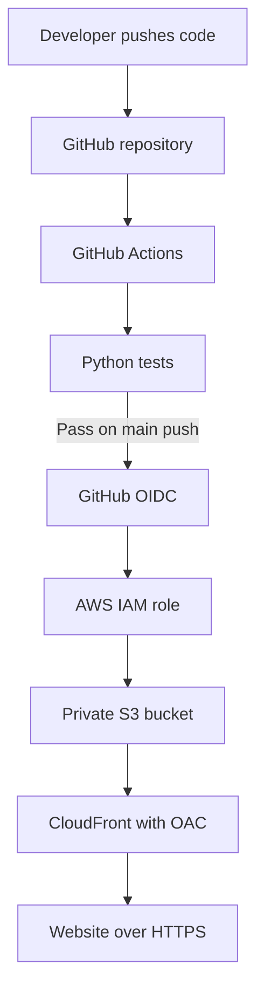
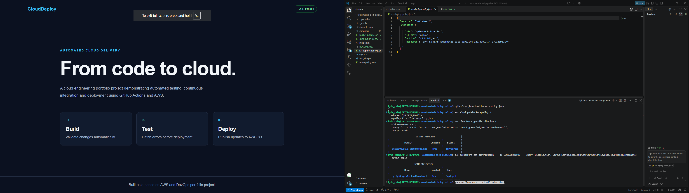
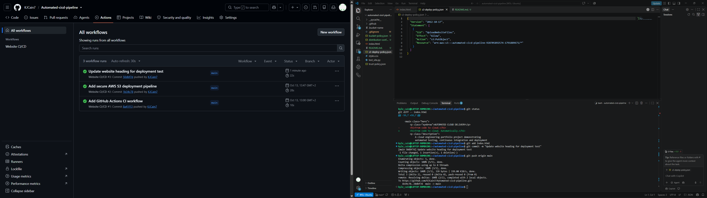
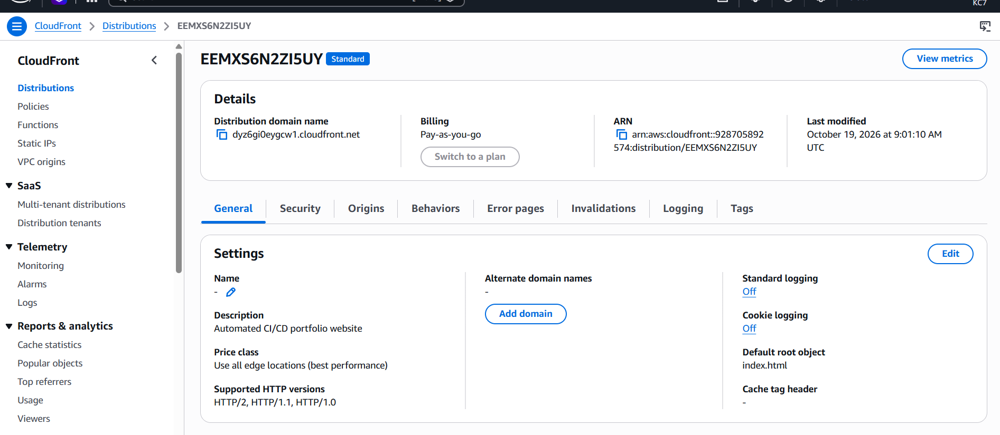
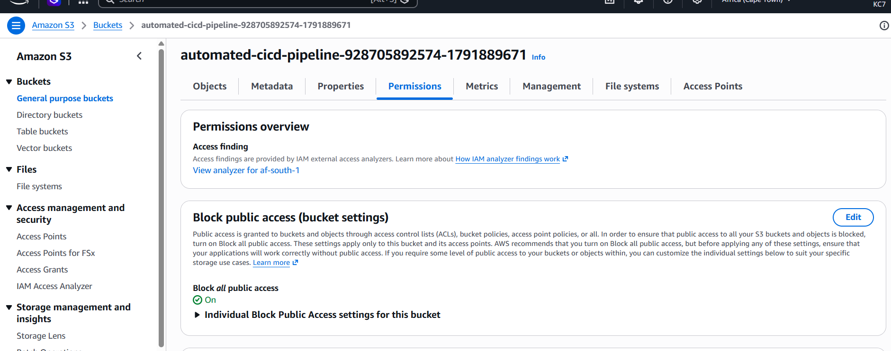
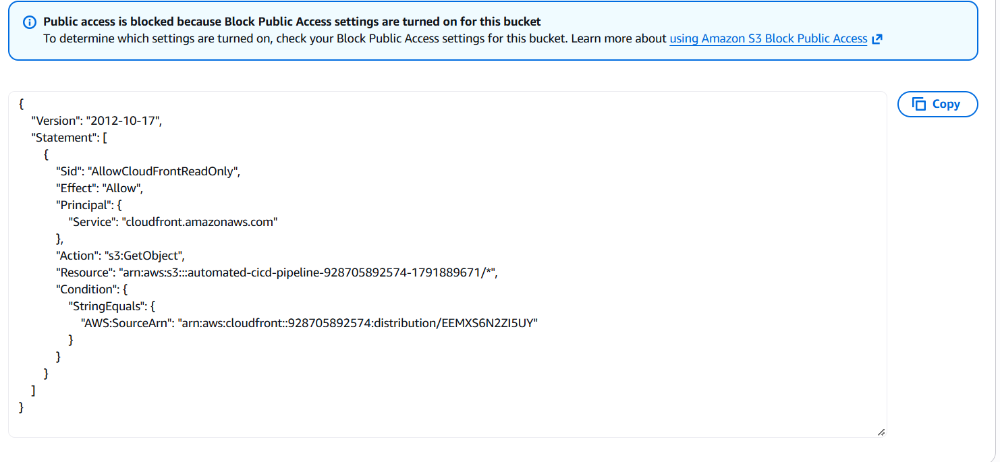
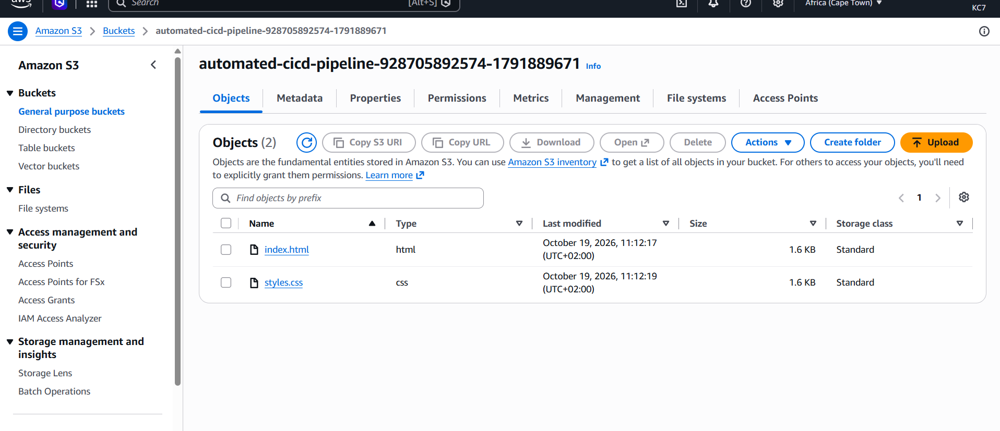
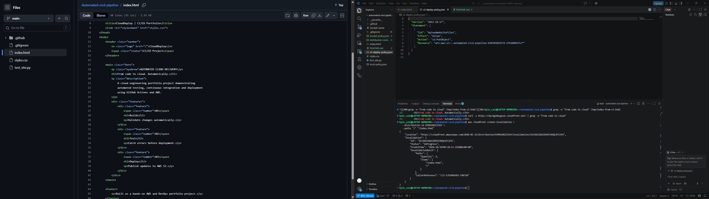

# Automated CI/CD Pipeline on AWS

A hands-on cloud engineering project that automatically tests and deploys a static website using GitHub Actions and AWS.

**Live demo:** https://dyz6gi0eygcw1.cloudfront.net/

## Project Overview

This project demonstrates a CI/CD pipeline for a static website. GitHub Actions runs automated Python tests and, when those tests pass on a push to `main`, deploys the website to Amazon S3.

Amazon CloudFront delivers the website over HTTPS while the S3 bucket remains private.

## Architecture



## Technologies Used

- Amazon S3
- Amazon CloudFront
- AWS IAM and OpenID Connect (OIDC)
- Origin Access Control (OAC)
- AWS CLI
- Git and GitHub
- GitHub Actions
- Python, HTML and CSS

## CI/CD Workflow

1. Code is pushed to GitHub.
2. GitHub Actions runs the Python tests.
3. On a push to `main`, successful tests allow the deployment job to run.
4. GitHub authenticates with AWS using OIDC to assume an IAM role.
5. The workflow uploads the website files to S3.
6. CloudFront serves the website over HTTPS.

Pull requests run validation, while deployment is restricted to pushes to `main`.

## Security Decisions

- S3 Block Public Access is enabled.
- S3 Object Ownership uses `BucketOwnerEnforced`.
- S3 uses server-side encryption with S3-managed keys (SSE-S3).
- The bucket policy restricts content access to the designated CloudFront distribution.
- CloudFront uses OAC to access the private S3 origin.
- GitHub Actions uses OIDC instead of long-lived AWS access keys.
- The deployment role is restricted to uploading objects to the project bucket.
- CloudFront redirects HTTP viewers to HTTPS and allows only GET and HEAD methods.

## Automated Tests

The tests in `test_site.py` check the page title, stylesheet reference and main heading.

Run the tests locally:

```bash
python3 -m unittest -v
```

## Repository Structure

```text
.github/workflows/ci.yml
index.html
styles.css
test_site.py
README.md
```

## Troubleshooting and Lessons Learned

### CloudFront showed an older version

CloudFront caches content to improve performance. After deployment, an older version may remain visible until the cache expires or is invalidated. For this project, a CloudFront invalidation was used to refresh the updated website.

### Keeping S3 private

A website does not need a publicly accessible S3 bucket when CloudFront can access the origin through OAC. Security Groups and network ACLs govern VPC network traffic; S3 access is controlled through IAM, bucket policies, Block Public Access and related S3 permissions.

## Cost Considerations

S3 storage, requests, CloudFront usage and related AWS resources may incur charges. Check AWS Billing and Cost Management regularly. AWS credits do not guarantee that every charge is covered.

## Potential Improvements

- Add HTML and CSS linting.
- Manage infrastructure using Terraform.
- Add appropriate CloudWatch monitoring and alarms.
- Automate CloudFront cache invalidation in the deployment workflow.
- Expand automated test coverage.

## What I Learned

- How CI and CD work together.
- How GitHub Actions automates testing and deployment.
- How OIDC provides temporary AWS credentials without storing long-lived access keys in GitHub.
- How IAM and S3 bucket policies control access.
- How CloudFront OAC supports a private S3 origin.
- How caching affects website updates.


## Screenshots

### 1. Live Website

The deployed website, served over HTTPS through Amazon CloudFront.



### 2. Automated CI/CD Pipeline

A successful GitHub Actions workflow showing automated testing and deployment.



### 3. CloudFront Distribution

The CloudFront distribution used to deliver the website.



### 4. S3 Security Configuration

S3 Block Public Access settings help prevent public access to the bucket.



### 5. S3 Bucket Policy

The bucket policy restricts CloudFront access to the designated distribution.



### 6. Deployed S3 Objects

The HTML and CSS files stored in the S3 deployment bucket.



### 7. Source Code

A view of the project's source code.


